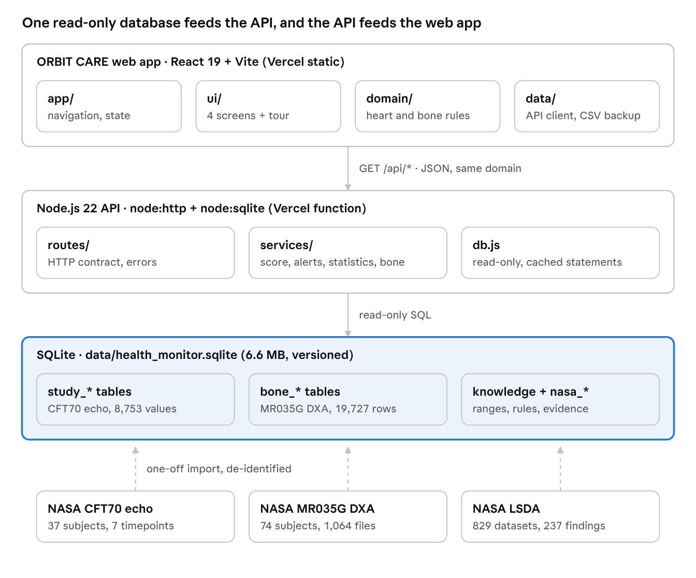
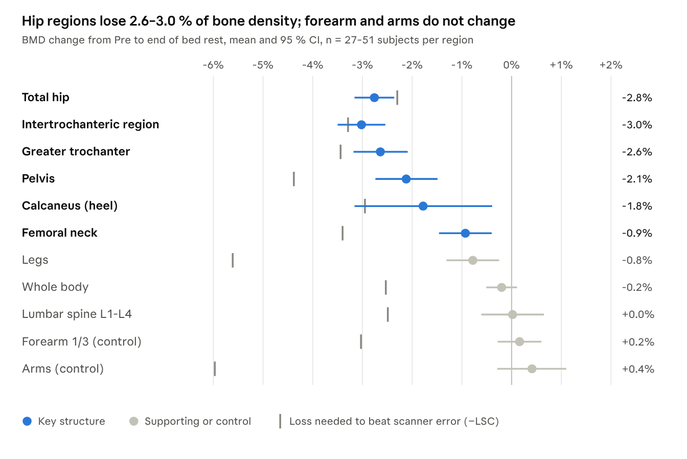

# Health Monitor for Astronauts: Final Technical Report

**Authors:** Ivan Luna Martínez, Cristhian Antonio Aguilar Vazquez, Erik Ulises Flores Contreras, Jorge Mauricio Sandoval Gómez, Jonathan Fructuoso Mercado

NASA Space Apps Challenge 2026 · Challenge: *Create Health Monitoring Software for Astronauts on Space Missions* · 11/15/26

## Abstract

**What we built.** Health Monitor for Astronauts is a web system that detects heart and bone deconditioning from real NASA bed-rest data. It turns each measurement into an alert, a recommended countermeasure and its evidence.

**How it works.** One SQLite database holds three public NASA sources: CFT70 echocardiography (37 subjects, 8,753 values), the Life Sciences Data Archive (829 datasets) and MR035G bone densitometry (74 subjects, 19,727 scans). A dependency-free Node.js API applies statistics and data mining, and the ORBIT CARE web app shows the results per subject. The whole stack runs on Vercel.

**What we found.**
- Without exercise, left-ventricular mass fell 13.7 % in 70 days; exercise limited the loss to 2.9–7.1 %.
- Changes below 6.5 % are reading error, so they raise no alert.
- The day-7 change anticipates day-70 muscle loss (AUC 0.73).
- The total hip lost 2.8 % of bone density, while non-weight-bearing sites did not change.

**Why it matters.** On long missions, astronauts must spot these changes themselves. Our system tells them whether a change is real (larger than the instrument's error) and what to do about it. It is an educational prototype, not a medical device.

## 1. Introduction

Without gravity, body fluids shift toward the head and plasma volume falls. The heart pumps less blood per beat and loses muscle, and weight-bearing bones lose mineral. On return, astronauts may faint when they stand up and face a higher fracture risk. Head-down tilt bed rest reproduces these changes on Earth and is NASA's main analog for studying them.

**Challenge.** NASA Space Apps asks for health monitoring software that gathers health indicators and lets astronauts evaluate and act on their own health status. Long missions bring radiation, isolation, altered gravity and a closed environment, with immune changes, bone loss, cardiovascular events and behavioral problems. We focus on the two risks with the richest public NASA data, cardiovascular deconditioning and bone loss, and cover behavioral health with a daily check-in. The system answers the three parts of the challenge:
- **Gather:** echocardiography, bone densitometry, daily mood, stress, sleep and symptoms, and live vitals (simulated).
- **Evaluate:** status per metric, a cardiac score by heart region, and bone loss per skeletal region, each against the instrument's error.
- **Act:** a recommended action and a countermeasure for each alert, backed by NASA evidence.

**Problem.** Astronauts and flight surgeons need to know, per crew member and per day, whether a measured change is real and dangerous, and what to do about it. Raw values are hard to read: a 5 % drop in LV mass may be reading error, and a normal cardiac output can hide a falling stroke volume.

**Objectives.**

1. Integrate real NASA data on cardiovascular and bone deconditioning into one database, with no synthetic or personal data.
2. Convert each measurement into a status, an alert, a recommended action and a countermeasure, filtered by measurement error.
3. Mine the data for effects, predictors and response patterns that support prevention.
4. Present the results per subject in a web application that a non-specialist can use.

**Contributions.**

- A curated SQLite database of three NASA sources, with verified citations and documented provenance (Section 3).
- A layered system: database, dependency-free Node.js API and React front end, deployed on Vercel (Sections 4 and 6).
- An error-aware assessment: alerts and bone-loss calls only when a change exceeds the instrument's minimum detectable change (Section 5).
- Data-mining results on group effects, reliability, early predictors, response phenotypes and skeletal sites (Section 7).

**What is new.**

- **Alerts that know their own error.** Most monitors compare a value with a fixed range. Ours first measures how much each instrument disagrees with itself: the two echo analysts and the repeated DXA scans. It then raises an alert only when a change is larger than that disagreement, which cuts false alarms (Sections 5.2 and 7.2).
- **Heart and bone in one view.** The heart and bone studies were run and published separately. We put both in one per-subject system, so a flight surgeon can follow both risks together.
- **From archive to action.** Each number goes from a raw NASA file to a status, an action, a countermeasure and the source behind it, and each step can be traced.
- **A wearable-style view for astronauts.** The screens borrow the language of smartwatches and fitness bands (daily trends, simple statuses and badges), so an astronaut can read their own heart and bone data without medical training.
- **Warning before the damage.** The day-7 echo anticipates the day-70 loss, so countermeasures can change while there is still time to act (Section 7.3).

Report outline:
- Section 2: background and related work.
- Sections 3–6: data, architecture, methods and implementation.
- Section 7: results.
- Section 8: discussion and limitations.
- Section 9: conclusion.

## 2. Background and Related Work

Bed rest and spaceflight cause the same two problems this system tracks: cardiac deconditioning and bone loss at weight-bearing sites.

- **Cardiac deconditioning.** Perhonen et al. (2001) showed cardiac atrophy after bed rest and spaceflight. NASA's 70-day bed rest study (CFT70; Cromwell et al., 2018) measured it with 2D/Doppler/TDI and 3D echocardiography in four groups: Control and three exercise protocols.
- **Echo reference ranges.** Clinical limits come from three guidelines: chamber quantification (Lang et al., 2015), diastolic function (Nagueh et al., 2016) and right-heart assessment (Rudski et al., 2010).
- **Bone loss.** Spaceflight removes about 1–1.5 % of hip bone mineral per month (Lang et al., 2004). In NASA/UTMB bed rest, loss concentrates at the hip, pelvis and heel (Spector et al., 2009). DXA results are read with WHO T-score categories (Kanis, 1994) and ISCD positions (Schousboe et al., 2013).
- **Measurement error.** A change is only real if it exceeds the instrument's error.
  - Readers: ICC and the standard error of measurement give the minimum detectable change (Shrout and Fleiss, 1979; Weir, 2005; Bland and Altman, 1986).
  - DXA: precision comes from repeated scans (Glüer et al., 1995), and the least significant change is 2.77 × precision (Baim et al., 2005).

**Design inspiration.**
- **Radiation monitoring.** A NASA page on space radiation showed how exposure is tracked against limits and acted on. We applied the same idea (measure, compare with a limit, act) to the heart and bones.
- **Consumer wearables.** Apps for Garmin-style watches and fitness bands inspired the charts, the daily check-in and the badges. We moved that experience from everyday users to astronauts and to cardiovascular and bone risks.

**Gap addressed.** Published studies report group averages. Few tools apply these error thresholds per subject and turn them into actions. None we found combine cardiac and bone data from the public NASA archives in one open, reproducible system.

## 3. Data

All data is real and public. The database is `data/health_monitor.sqlite` (6.6 MB, versioned in the repository, read-only at run time).

| Source | Content | Subjects | Records kept |
| --- | --- | --- | --- |
| NASA CFT70 / BRSMCF echocardiography | 2D/Doppler/TDI and 3D echo, 7 timepoints (Pre, D7, D21, D30, D70, R+0, R+3), 4 groups | 37 (+1 unassigned) | 7,890 measured + 863 derived values |
| NASA LSDA evidence | Cardiovascular datasets, experiments and published findings | — | 829 datasets, 158 experiments, 237 findings |
| NASA MR035G DXA | Hip, spine, forearm, heel and whole body; UTMB Campaigns 3 and 1, AG pilot, MEDES | 74 | 19,727 measurements, 11 regions, 4 parameters |

**Preprocessing.**

- **Echo:**
  - The two identical 7-subject files were merged.
  - A 0.0 in the subset was treated as missing.
  - The 3D column `LVSV` was identified as end-systolic volume.
  - Derived metrics are computed with clinical formulas, and the formula is stored with each value: stroke volume (EDV − ESV), ejection fraction, cardiac output (SV × HR / 1000), Tei index ((IVCT + IVRT) / ET), RV systolic pressure (4 × TR² + 3 mmHg) and average E/e′.
- **DXA:**
  - 1,064 Hologic exports in 11 formats were parsed generically.
  - Rows were de-duplicated by subject, region, side, parameter and scan ID (38,493 → 19,727).
  - Visits were coded from the bed-rest phase and day (PRE, BR_END, R+n, 6-month and 1-year follow-up).
  - Scans in the 2006 scanner recalibration window are flagged.
- **Scope reduction:** removed the synthetic crew of earlier versions, the metrics without real data (SpO₂, temperature) and the non-cardiovascular problems. Size fell from 9.4 MB to 3.6 MB before the bone data was added.

**De-identification.**
- Subjects keep NASA's anonymous codes.
- Echo analysts' names were replaced by A1–A3.
- From the DXA files, a last-name column, birth dates, ethnicity, scanner keys and absolute dates were not imported; only the day relative to the first scan is stored.

**Schema.** Five groups of tables:
- knowledge: problems, metrics, reference ranges, change thresholds, alert rules, countermeasures and 33 sources;
- study: `study_*`;
- cardiac score: `cardiac_region`, `region_metric`;
- bone: `bone_campaign`, `bone_subject`, `bone_region`, `bone_parameter`, `bone_measurement`;
- evidence: `nasa_*`.

`data/schema.sql` rebuilds exactly the same objects, and integrity and foreign-key checks report 0 errors.

## 4. System Architecture

The system has three runtime layers, each using only the one below it. An offline import is the only path for data to enter the database.



**Design decisions.**

- **Database in the repository, read-only.** The SQLite file is versioned with the code, so every result is reproducible from a commit, and the API opens it read-only. Data changes are SQL migrations, documented in the methodology.
- **No backend framework or dependencies.** Node.js 22 ships `node:http` and `node:sqlite`. That removes supply-chain risk and lets the same handler run locally and as one Vercel function.
- **Compute once, serve from memory.** The dataset is small (about 30,000 values), so it is loaded at start and analytics results are memoized.
- **Graceful degradation.** The web app falls back to bundled CSV files if the API is down. Screens that need the database (bone density) say so instead of showing invented values.

## 5. Methods

Every decision is measured against the subject's own baseline (Pre) and against the error of the instrument.

### 5.1 Metric status and cardiac score
Each metric gets a status from two rules, and the worse one wins:
- its absolute value against a clinical range (`medical_reference`);
- its % change from baseline against a warning and a critical threshold (`change_threshold`).

Each metric then gets a severity from 0 to 1. Metrics are grouped into five heart regions with weights from 0.30 (left ventricle) down to 0.10. The score is:

```latex
\text{score} = 100\left(1 - \frac{\sum_i w_i\, s_i}{\sum_i w_i}\right)
```

Bands: Nominal ≥ 80, Attention 60–79, Critical < 60. A value beyond a clinical critical limit makes its region critical regardless of the score.

### 5.2 Measurement-error filter
- **Echo:** two analysts read the same 3D images.
  - Agreement is measured with ICC(2,1), SEM = √MSE and Bland–Altman limits.
  - The minimum detectable change of the mean of two readings is MDC95 = 1.96 × SEM.
  - A 3D change smaller than the MDC is lowered one alert level and flagged `within_measurement_error`.
- **DXA:** precision is the RMS-SD of the repeated PRE scans as a percentage of the mean, and LSC = 2.77 × precision.

### 5.3 Data mining

| Task | Technique | Question answered |
| --- | --- | --- |
| Group effects | One-sample and Welch t-tests, 95 % CI, Hedges' g | Which countermeasure protected the heart? |
| Reliability | ICC(2,1), SEM, MDC95, Bland–Altman | Which changes are real? |
| Correlations | Pearson and Spearman, Benjamini–Hochberg FDR | Which changes move together? |
| Early predictors | Linear regression D7 → D70 and D70 → R+0 | Can we warn early? |
| Early-warning validation | Bootstrap AUC, permutation test, leave-one-subject-out ridge logistic regression, Brier skill | Does the day-7 signal hold out of sample? |
| Trend alarm | CUSUM in units of measurement error | Is a decline sustained? |
| Phenotypes | k-means++ (k = 2, 50 seeded restarts), silhouette | Are there response profiles? |
| Bone loss | Paired % change PRE → end of bed rest, t-test, standardized response, % beyond LSC | Which skeletal structures matter most? |

All statistics are implemented without libraries (`backend/src/services/stats.js`, `mining.js`) and checked against reference values.

## 6. Implementation

The code is about 1,900 lines of backend and 2,400 lines of front end. The backend has no dependencies; the front end has three at run time (React, React DOM and a font).

**Backend (Node.js 22, `node:http` + `node:sqlite`).**
- **Layers:** `routes/` (HTTP contract) → `services/` (domain and analytics) → `db.js` (one read-only connection with cached prepared statements).
- **Performance:** the dataset is loaded into memory once and analytics results are memoized, so responses take about 1 ms.
- **Robustness:** a malformed URL returns 400 and never stops the server.

| Module | Responsibility |
| --- | --- |
| `services/dataset.js` | Loads CFT70 and the knowledge base; values, % change, timepoints |
| `services/assessment.js` | Metric status, cardiac score, ASE diastolic function, alerts, recommendations |
| `services/analytics.js` | Group effects, reliability, correlations, predictors, phenotypes, early warning |
| `services/stats.js`, `mining.js` | t-tests, CI, Hedges' g, ICC, BH, k-means++, AUC, CUSUM, ridge logistic regression |
| `services/bone.js` | Bone loss by region vs LSC, ranking, subject timeline |

**Front end (ORBIT CARE, React 19 + Vite).** The code is organized in layers:
- `app/`: composition;
- `ui/`: views, components and styles;
- `domain/`: heart and bone rules, simulated vitals, check-in and tour steps;
- `data/`: API client, echo loader with CSV fallback and bone loader.

Screens:

1. **Heart monitor:** interactive heart by region, findings, % change timeline, health tips, echo table.
2. **Countermeasures:** group bars with Welch p and Hedges' g vs Control, crew table.
3. **Daily check-in:** mood, stress, sleep and symptoms with instant guidance, week and badges.
4. **Bone density:** diverging bars of loss by region with 95 % CI and the ±LSC band, key structures, subject timeline.

Each screen has a guided tour that highlights its real elements. Pulse and SpO₂ marked LIVE SIM are simulated. Missing echo values are completed from the same database and shown in italics.

**Deployment.**
- Vercel serves the front end from `frontend/` and runs the whole API as one function (`frontend/api/index.js`) on the same domain.
- `vercel.json` rewrites every `/api/*` path to that function.
- If the API does not answer in 5 s, the app falls back to the bundled CSV files.

**Testing.**
- 30 automated tests (`node --test`): 22 endpoint tests (contracts, errors, robustness, bone) and 8 tests of the statistics module against reference values.
- The front end passes ESLint.
- It was checked with headless-browser screenshots on desktop and mobile, locally and in production.

## 7. Evaluation and Results

Exercise protects the heart, the end-of-mission echo predicts trouble on return, and bone is lost only where it carries weight.

### 7.1 Countermeasure effects (LV mass, day 70 vs Pre)

| Group | Mean change | p vs baseline | vs Control |
| --- | --- | --- | --- |
| Control | −13.7 % | < 0.001 | — |
| Exercise A | −7.1 % | 0.069 | p = 0.136, g = 0.72 |
| Flywheel | −4.9 % | — | p = 0.033, g = 1.0 |
| Exercise B | −2.9 % | — | p = 0.011, g = 1.21 |

- Differences between exercise protocols are not significant.
- Cardiac output stays flat because heart rate rises to compensate for the lower stroke volume, so a normal output can hide deconditioning.
- LVOT VTI is the strongest single signal (Exercise B vs Control: g = 2.18, p < 0.001), and it needs only 2D Doppler.

### 7.2 Reliability of the 3D echo

| Metric | ICC(2,1) | MDC95 (mean of 2 analysts) |
| --- | --- | --- |
| LV mass | 0.944 | 6.5 % |
| Stroke volume | 0.852 | 12.9 % |
| Ejection fraction | 0.516 | — (unreliable) |

The original 5 % LV-mass warning threshold was below reading error. Changes under the MDC no longer raise alerts.

### 7.3 Early predictors
Significant after Benjamini–Hochberg correction (q < 0.05):

- LV mass change at D7 → change at D70: r = 0.58.
- At D70, E/A (r = −0.61), heart rate (r = 0.50), LVOT VTI (r = −0.49) and LV mass (r = −0.47) predict the heart-rate rise on standing at R+0.

Out-of-sample validation of the day-7 warning (event = LV-mass loss ≥ 6.5 % at D70, n = 35, 19 events):
- AUC 0.73 (bootstrap 95 % CI 0.54–0.89), permutation p = 0.009.
- Leave-one-subject-out: AUC 0.67, Brier skill 0.09, sensitivity 0.68, specificity 0.50.

The signal is modest, so the trend alert is a warning, not a critical alert.

### 7.4 Cardiac score and phenotypes
- **Score validation (in-sample):**
  - All subjects score Nominal at Pre.
  - Mean score at D70: Control 53, Flywheel 71, Exercise A 81, Exercise B 83.
  - AUC Control vs exercise: D7 0.74, D70 0.97, R+0 0.95, R+3 0.83.
- **Discarded rule:** the first rule (status = worst metric) flagged 31 of 38 subjects as critical, so the score replaced it.
- **Phenotypes:** k-means++ found a high-deconditioning profile (12 subjects, 8 of them Control) and a protected one (22, 2 Control). The structure is weak (silhouette 0.21).

### 7.5 Bone loss by skeletal region
Across 51 subjects with labeled phases (27 UTMB Campaign 3, 24 MEDES), the hip regions lose the most, and the forearm and arms do not change.



- **Key structures:** total hip, intertrochanteric region, trochanter, pelvis, heel and femoral neck. The total hip is the most reliable to follow: 63 % of subjects lost more than its 2.3 % LSC.
- **Relevant parameters:** BMD as % change from the subject's own Pre value, compared with the region's LSC, and the Z-score for young adults (≤ −2.0 is below the expected range for age).

Full table: [`BONE_DENSITY.md`](BONE_DENSITY.md).

### 7.6 Software verification
- 30/30 tests pass.
- Database integrity and foreign-key checks report 0 errors.
- Front-end CSV and API data agree on 3,329 of 3,331 compared values. The 2 differences are EF averaged per analyst in the database.
- Production on Vercel serves every endpoint with no page errors.

## 8. Discussion and Limitations

The main design lesson is that an alert is only useful when it respects the instrument's error. Without the MDC and LSC filters, most subjects would be flagged and the alerts would be ignored.

**Threats to validity.**

- **Analog, not flight.** Bed rest reproduces unloading but not radiation, isolation or real fluid dynamics. Bone losses in flight are larger than the 60–70-day bed rest values here.
- **Small groups.** CFT70 groups have 7–11 subjects, and only 51 bone subjects have labeled phases. Effects between exercise protocols cannot be separated.
- **In-sample score validation.** Thresholds, region weights and score bands were tuned on the same data used to report the AUC. Only the early-warning model was validated out of sample.
- **Heuristic thresholds.** Change thresholds, region weights and score bands are project heuristics and need medical review.
- **Imputation in the web app.** About 2,600 displayed echo values (next to 6,400 measured) are filled from the same database. They are marked in italics and group statistics use only measured values, but a reader may still mistake them for measurements.
- **Simulated vitals.** Live pulse, SpO₂ and ECG are simulated and labeled LIVE SIM.
- **Precision is a lower bound.** Inter-analyst and same-day repeat scans miss the variation of a new acquisition on another day.
- **Unknown cohorts.** Campaign 3 cohorts (C3A–C3H) may include countermeasure groups that the files do not name, so bone groups are not compared.

**Ethics and privacy.** Only public, de-identified NASA data is used. Names, birth dates, ethnicity and absolute dates were removed, and analysts are coded. The system is an educational prototype, not a medical device.

## 9. Conclusion and Future Work

Public NASA bed-rest data, read against each instrument's measurement error, is enough to build a working early-warning system for cardiac and bone deconditioning. Health Monitor for Astronauts is deployed, tested and documented, and every number it shows can be traced to its source.

Future work:

- Validate the score on an independent cohort or on spaceflight data.
- Medical review of the heuristic thresholds, region weights and score bands.
- Show more of the API in the web app: score by region, predictors, phenotypes and the early-warning model.
- Add a write path to store daily check-ins, and authentication with crew and flight-surgeon roles.
- Model bone recovery after bed rest from the 6-month and 1-year follow-up scans.

## References

All DOIs were checked in Crossref (11/14/26–11/15/26).

1. Baim S, Wilson CR, Lewiecki EM, Luckey MM, et al. Precision assessment and radiation safety for dual-energy X-ray absorptiometry: position paper of the ISCD. *J Clin Densitom.* 2005;8(4):371–378. [doi:10.1385/JCD:8:4:371](https://doi.org/10.1385/JCD:8:4:371)
2. Bland JM, Altman DG. Statistical methods for assessing agreement between two methods of clinical measurement. *Lancet.* 1986;327(8476):307–310. [doi:10.1016/S0140-6736(86)90837-8](https://doi.org/10.1016/S0140-6736(86)90837-8)
3. Cromwell RL, Scott JM, Downs M, et al. Overview of the NASA 70-day Bed Rest Study. *Med Sci Sports Exerc.* 2018;50(9):1909–1919. [doi:10.1249/MSS.0000000000001617](https://doi.org/10.1249/MSS.0000000000001617)
4. Glüer CC, Blake G, Lu Y, Blunt BA, et al. Accurate assessment of precision errors: how to measure the reproducibility of bone densitometry techniques. *Osteoporos Int.* 1995;5(4):262–270. [doi:10.1007/BF01774016](https://doi.org/10.1007/BF01774016)
5. Hedges LV. Distribution theory for Glass's estimator of effect size and related estimators. *J Educ Stat.* 1981;6(2):107–128. [doi:10.3102/10769986006002107](https://doi.org/10.3102/10769986006002107)
6. Kanis JA. Assessment of fracture risk and its application to screening for postmenopausal osteoporosis: synopsis of a WHO report. *Osteoporos Int.* 1994;4(6):368–381. [doi:10.1007/BF01622200](https://doi.org/10.1007/BF01622200)
7. Lang RM, Badano LP, Mor-Avi V, et al. Recommendations for cardiac chamber quantification by echocardiography in adults. *J Am Soc Echocardiogr.* 2015;28(1):1–39. [doi:10.1016/j.echo.2014.10.003](https://doi.org/10.1016/j.echo.2014.10.003)
8. Lang T, LeBlanc A, Evans H, Lu Y, et al. Cortical and trabecular bone mineral loss from the spine and hip in long-duration spaceflight. *J Bone Miner Res.* 2004;19(6):1006–1012. [doi:10.1359/jbmr.040307](https://doi.org/10.1359/jbmr.040307)
9. Nagueh SF, Smiseth OA, Appleton CP, et al. Recommendations for the evaluation of left ventricular diastolic function by echocardiography. *J Am Soc Echocardiogr.* 2016;29(4):277–314. [doi:10.1016/j.echo.2016.01.011](https://doi.org/10.1016/j.echo.2016.01.011)
10. NASA Life Sciences Data Archive. Bed Rest Standard Measures: Cardiovascular Function (BRSMCF), CFT70 echocardiography; and Bone Densitometry Assessment (MR035G), DXA. [nlsp.nasa.gov](https://nlsp.nasa.gov/explore/data)
11. Perhonen MA, Franco F, Lane LD, et al. Cardiac atrophy after bed rest and spaceflight. *J Appl Physiol.* 2001;91(2):645–653. [doi:10.1152/jappl.2001.91.2.645](https://doi.org/10.1152/jappl.2001.91.2.645)
12. Rudski LG, Lai WW, Afilalo J, et al. Guidelines for the echocardiographic assessment of the right heart in adults. *J Am Soc Echocardiogr.* 2010;23(7):685–713. [doi:10.1016/j.echo.2010.05.010](https://doi.org/10.1016/j.echo.2010.05.010)
13. Schousboe JT, Shepherd JA, Bilezikian JP, Baim S. Executive summary of the 2013 ISCD Position Development Conference on bone densitometry. *J Clin Densitom.* 2013;16(4):455–466. [doi:10.1016/j.jocd.2013.08.004](https://doi.org/10.1016/j.jocd.2013.08.004)
14. Shrout PE, Fleiss JL. Intraclass correlations: uses in assessing rater reliability. *Psychol Bull.* 1979;86(2):420–428. [doi:10.1037/0033-2909.86.2.420](https://doi.org/10.1037/0033-2909.86.2.420)
15. Spector ER, Smith SM, Sibonga JD. Skeletal effects of long-duration head-down bed rest. *Aviat Space Environ Med.* 2009;80(5):A23–A28. [doi:10.3357/asem.br02.2009](https://doi.org/10.3357/asem.br02.2009)
16. Weir JP. Quantifying test-retest reliability using the intraclass correlation coefficient and the SEM. *J Strength Cond Res.* 2005;19(1):231–240. [doi:10.1519/15184.1](https://doi.org/10.1519/15184.1)

## Appendix A. API

All endpoints are `GET` and return JSON. Live at [health-monitor-for-astronauts.vercel.app](https://health-monitor-for-astronauts.vercel.app).

| Endpoint | Returns |
| --- | --- |
| `/api/subjects`, `/api/subjects/:code`, `/api/subjects/:code/echo` | Subjects by score; one subject's dashboard; echo table |
| `/api/study/cft70/echo-data` | Every echo value (what the web app loads) |
| `/api/study/cft70/effects`, `/countermeasures` | Group effects with CI, p, Hedges' g |
| `/api/analytics/reliability`, `/correlations`, `/predictors`, `/phenotypes`, `/early-warning` | Data-mining results |
| `/api/bone`, `/api/bone/subjects`, `/api/bone/subjects/:code` | Bone loss by region, ranking, subject timeline |
| `/api/alerts`, `/api/problems`, `/api/reference` | Alerts, cardiovascular problems, reference ranges and sources |

## Appendix B. Reproducibility

```bash
cd backend && npm start     # API on :8000 (Node.js >= 22.13)
cd backend && npm test      # 30 tests
cd frontend && npm install && npm run dev   # web app on :5173
```

- **Code, database and documentation:** GitHub `N0x370z/Health_Monitor_for_Astronauts`, branch `main`.
- **Method and change log:** `docs/DATA_METHODOLOGY.md`.
- **Bone analysis:** `docs/BONE_DENSITY.md`.

## Appendix C. Team contributions

| Area | Contribution |
| --- | --- |
| Database, backend and data mining (branch `Neo`) | Data curation, SQLite schema, Node.js API, statistics, bone analysis, integration, deployment, documentation |
| Front end (Mausg08, branch `v2-frontend`) | ORBIT CARE design: heart monitor, countermeasures, daily check-in, simulated live vitals |
| Validation (Erik, branch `Erik`) | Out-of-sample early-warning validation and CUSUM trend alarm |
